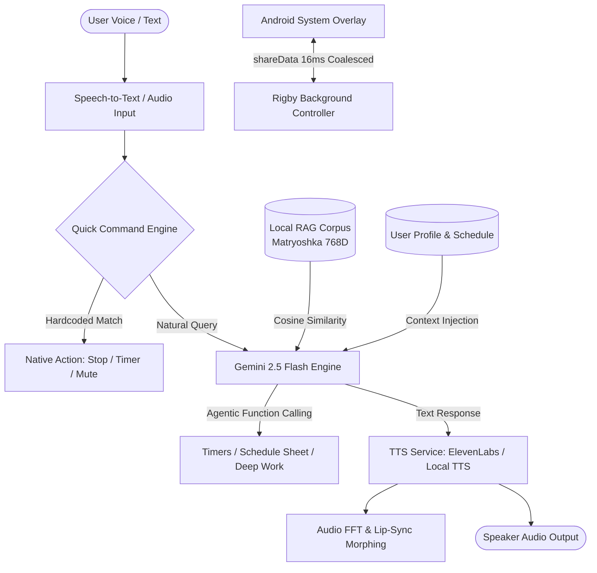

# Rigby — AI Academic Voice Assistant

<p align="center">
  
</p>

<p align="center">
  <b>A real-time, proactive AI Voice Assistant for students, featuring an Android Dynamic Island system overlay, local Matryoshka vector search (RAG), and procedural lip-sync animations.</b>
</p>

<p align="center">
  
  
  
  
  
  
</p>

---

## 🌟 Highlights & Technical Innovation

Rigby is engineered as a complete speech-to-speech ambient assistant designed for university students (Faculty of Mathematics and Informatics, Ovidius University of Constanța). It combines advanced client-side orchestration, local vector embeddings, and low-level native Android features.

### 1. 🗣️ Real-time Speech-to-Speech Pipeline
- **Hybrid Voice Engine**: Supports cloud-grade ultra-realistic synthesis via **ElevenLabs** with an in-memory HTTP proxy pipe for immediate byte-level streaming playback, with fallback to zero-cost on-device **Flutter TTS**.
- **Speech Token Synchronization**: Monotonic utterance tracking prevents race conditions and audio overlap during rapid user interruptions.
- **Multilingual Support**: Real-time STT and system prompt localization across Romanian, English, and French.

### 2. 🏝️ Dynamic Island Background Overlay
- **Cross-App Android System Overlay**: Floats on top of all third-party applications when the app is backgrounded.
- **16ms Event Coalescing**: Smooth frame-synced throttling prevents UI jitter across rapid state changes (`speaking` → `idle` → `timer`).
- **Touch-Through Optimization**: Dynamically toggles `FLAG_NOT_TOUCHABLE` so users interact normally with their phone, switching to active gesture tracking only when needed (tap-to-stop speech, swipe-to-dismiss timers).

### 3. 📚 Client-Side Vector RAG (Retrieval-Augmented Generation)
- **Matryoshka Representation**: Embeddings (768D) generated via `gemini-embedding-001`, indexed with academic regulations, scholarship rules, and timetables.
- **Zero-Latency In-Memory Cosine Similarity**: Preloaded on startup in the background so query evaluations take under 5ms on device without requiring external vector databases.
- **Profile-Aware Context Slicing**: Queries are automatically filtered by student specialization, year, and group.

### 4. 🎭 Procedural Lip-Sync Mascot
- **Custom Bezier Morphing**: Renders SVG paths directly on canvas, dynamically computing lip contours based on audio amplitude and formant ratio (smoothly morphing vowel geometry between wide `E/I` and rounded `O/U`).
- **Squint & Quantum Thinking Animations**: Interactive eye blinking, tilt physics, and deterministic seeded particle fields during AI inference.

### 5. ⏰ Proactive Schedule Engine & Function Calling
- **Deep Work / DND Mode**: Activates Android Do-Not-Disturb and focus countdown timers.
- **Automated Timetable Analysis**: Background periodic engine inspects student class schedules, detecting windows/free slots between courses and issuing proactive push notifications with encouraging briefings.
- **Gemini Agentic Tools**: Model uses autonomous function calling (`openScheduleSheet`, `startTimer`, `setReminder`, `activateDeepWork`).

---

## 🏗️ Architecture



---

## 📂 Repository Structure

```
lib/
├── app/                  # Application root configuration and routes
├── core/
│   ├── config/           # API Keys and build-time configuration
│   ├── models/           # App settings, user profile, and schedule models
│   ├── services/         # Core singletons:
│   │   ├── gemini_service.dart           # AI orchestration & function calling
│   │   ├── rag_service.dart              # Vector search & cosine similarity
│   │   ├── tts_service.dart              # ElevenLabs & local audio playback
│   │   ├── schedule_service.dart         # Timetable querying and parsing
│   │   ├── proactive_engine.dart         # Background periodic timetable worker
│   │   ├── deep_work_service.dart        # DND focus mode manager
│   │   ├── audio_visualizer.dart         # FFT amplitude and formant analysis
│   │   └── notification_service.dart     # System notifications
│   └── theme/            # Minimalist dark/light neon design system
└── features/
    ├── auth/             # Multi-step authentication & student onboarding
    ├── chat/             # Main vocal screen, mascot, and modal sheets
    ├── island/           # Android Dynamic Island system overlay
    ├── settings/         # Preferences, voice model selection, STT locale
    └── splash/           # Vector SVG logo drawing animation
```

---

## 🚀 Getting Started

### Prerequisites
- [Flutter SDK](https://flutter.dev/docs/get-started/install) (>= 3.3.0)
- Android SDK (API Level 26+ recommended for Foreground Service and System Overlays)
- A [Google Gemini API Key](https://aistudio.google.com/)
- (Optional) An [ElevenLabs API Key](https://elevenlabs.io/) for premium voices

### 1. Clone the repository
```bash
git clone https://github.com/DockTypes/rigby.git
cd rigby
flutter pub get
```

### 2. Configure API Keys

You can configure keys using either of the following approaches:

#### Option A: Copy the configuration template (Recommended for development)
```bash
cp lib/core/config/api_keys.dart.example lib/core/config/api_keys.dart
```
Edit `lib/core/config/api_keys.dart` with your keys. *(Note: `api_keys.dart` is git-ignored to prevent credential leaks).*

#### Option B: Supply keys at build time via `--dart-define`
```bash
flutter run \
  --dart-define=GEMINI_KEY="your_gemini_api_key" \
  --dart-define=ELEVEN_LABS_KEY="your_elevenlabs_api_key"
```

### 3. Run the application
```bash
flutter run
```

> **Note on Android Permissions:** 
> - Dynamic Island requires the **"Display over other apps"** permission.
> - Background voice listening requires **Microphone** and **Battery optimization exemption** for optimal foreground service lifetime.

---

## 🧪 Testing & Code Quality

The codebase enforces strict linting and includes automated unit tests covering intent recognition, tag parsers, and timetable mapping:

```bash
# Analyze code health
flutter analyze

# Execute unit and service test suites
flutter test
```

---

## 🛡️ Security & Privacy
- **Zero Credentials in Version Control**: All API keys are isolated behind git-ignored configuration and environment definitions.
- **Local Speech Processing**: Fallback TTS and wake word listeners execute completely offline on-device.
- **Student Data Privacy**: Academic profile information is stored locally in device private storage (`SharedPreferences`) without external telemetry.

---

## 📄 License
This project is licensed under the MIT License — see the [LICENSE](LICENSE) file for details.
